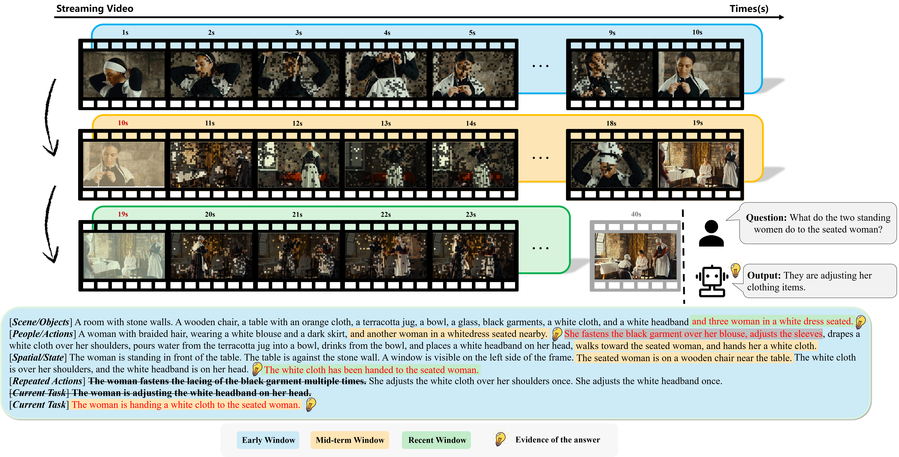
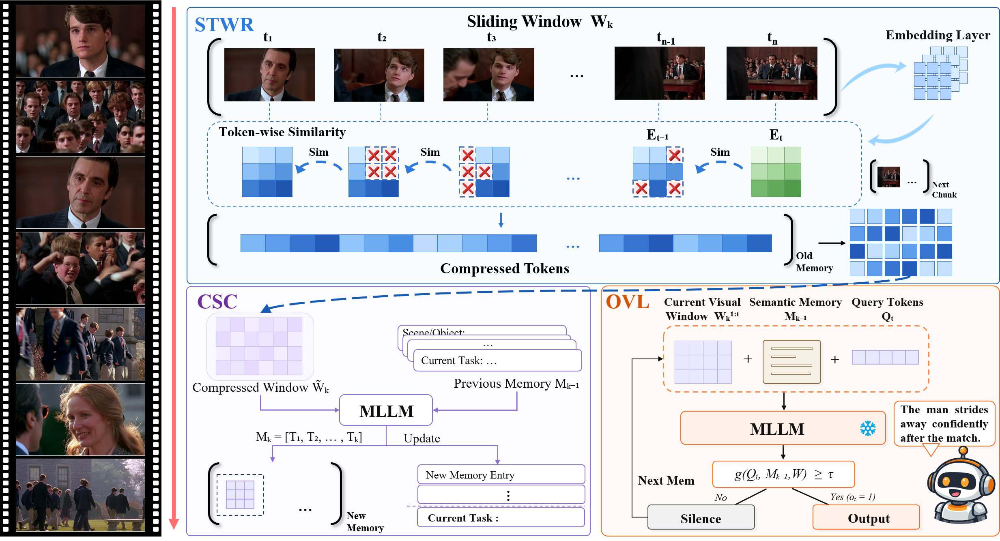
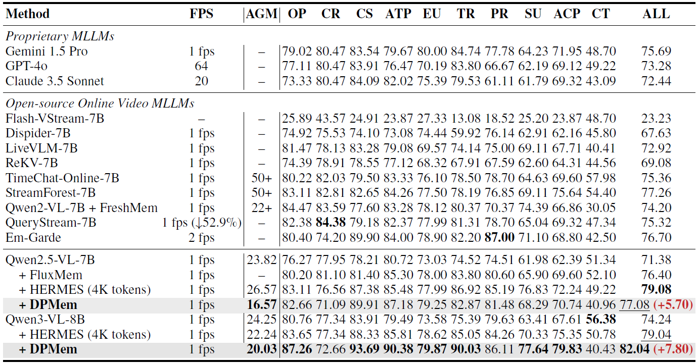
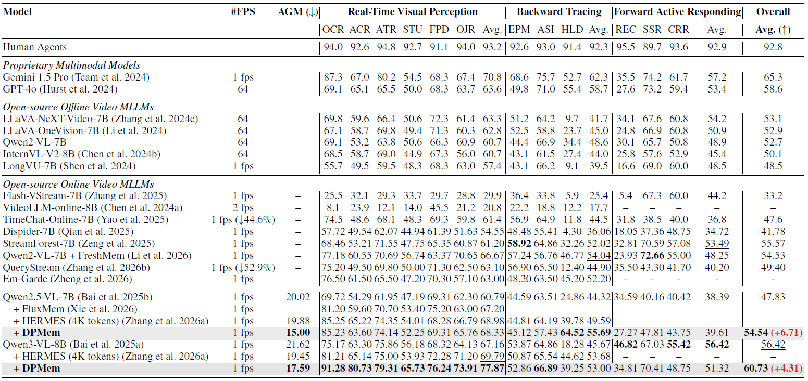

<div align="center">

# DPMem

**Training-Free Dual-loop Memory Compression for Streaming Video Understanding**

[](https://www.python.org/)
[](https://github.com/QwenLM/Qwen3-VL)
[](LICENSE)

Paper coming soon

</div>

> DPMem is a lightweight, training-free framework for streaming video understanding. It combines short-term visual redundancy compression with recurrent semantic memory so that pretrained video MLLMs can retain recent visual details and long-range temporal context under a bounded memory budget.



## Highlights

- **Training-free integration.** DPMem works with pretrained video MLLMs without additional finetuning.
- **Short-term visual memory.** Short-Term Window Redundancy Compression removes redundant spatial tokens across adjacent frames while preserving temporal boundaries.
- **Long-term semantic memory.** Continuous Semantic Consolidation converts compressed windows into a discrete and structured text sequence that is updated throughout the stream.
- **Online response control.** The current visual window, consolidated history, and incoming query are jointly used to answer immediately or wait for additional evidence.
- **Online and offline evaluation.** The released scripts cover StreamingBench and OVO-Bench. Offline benchmarks follow the evaluation protocol of lmms-eval v0.7.1.

## Method Overview

<p align="center">
  
</p>

DPMem combines short-term visual redundancy compression with continuous semantic consolidation to maintain fine-grained visual evidence and long-range temporal context during streaming inference.

## Repository layout

```text
DPMem/
├── assets/                         # README figures
├── models/
│   ├── qwen2_5_vl/                # Qwen2.5-VL model adapter
│   └── qwen3_vl/                  # Qwen3-VL model adapter and token compression
├── scripts/
│   ├── streamingbench_dpmem.py    # StreamingBench inference and evaluation
│   ├── ovobench_dpmem.py          # OVO-Bench inference and evaluation
│   ├── run_streamingbench.sh      # StreamingBench launcher
│   └── run_ovobench.sh            # OVO-Bench launcher
├── tools/
│   └── compare_cuda_memory.py     # Compare memory records from two JSONL files
├── requirements.txt
├── LICENSE
└── README.md
```

## Implementation map

| Component | Main files |
| --- | --- |
| Qwen3-VL visual token compression | [`models/qwen3_vl/modeling_qwen3_vl_drop_prev.py`](models/qwen3_vl/modeling_qwen3_vl_drop_prev.py) |
| Optional memory-aligned frame scoring | [`models/qwen3_vl/meks.py`](models/qwen3_vl/meks.py) |
| Qwen2.5-VL visual token compression | [`models/qwen2_5_vl/modeling_qwen2_5_vl_DTD_me.py`](models/qwen2_5_vl/modeling_qwen2_5_vl_DTD_me.py) |
| Continuous semantic memory and StreamingBench evaluation | [`scripts/streamingbench_dpmem.py`](scripts/streamingbench_dpmem.py) |
| Continuous semantic memory and OVO-Bench evaluation | [`scripts/ovobench_dpmem.py`](scripts/ovobench_dpmem.py) |
| Launch commands | [`scripts/run_streamingbench.sh`](scripts/run_streamingbench.sh), [`scripts/run_ovobench.sh`](scripts/run_ovobench.sh) |
| GPU memory comparison | [`tools/compare_cuda_memory.py`](tools/compare_cuda_memory.py) |

## Installation

The following environment matches the environment used to run the released code.

```bash
conda create -n dpmem python=3.10 -y
conda activate dpmem

python -m pip install --upgrade pip setuptools wheel
python -m pip install torch==2.7.1 torchvision==0.22.1 --index-url https://download.pytorch.org/whl/cu128
python -m pip install -r requirements.txt
```

DPMem uses FFmpeg for video decoding. Install it through the operating system or Conda.

```bash
sudo apt update
sudo apt install -y ffmpeg
```

Flash Attention is recommended. Install a wheel that matches Python 3.10, PyTorch 2.7, and the CUDA runtime in your environment. A compatible source build can also be installed as follows.

```bash
python -m pip install flash-attn==2.8.2 --no-build-isolation
```

Verify the core imports after installation.

```bash
python -c "import torch, transformers, accelerate; print(torch.__version__, transformers.__version__, accelerate.__version__)"
python -c "from models.qwen3_vl import Qwen3VLForConditionalGeneration; print('DPMem import OK')"
```

## Model preparation

The default checkpoint is [`Qwen/Qwen3-VL-8B-Instruct`](https://huggingface.co/Qwen/Qwen3-VL-8B-Instruct). The launchers accept either this Hugging Face identifier or a local checkpoint path through `QWEN3_VL_CKPT_PATH`.

```bash
export QWEN3_VL_CKPT_PATH=Qwen/Qwen3-VL-8B-Instruct
```

## Data preparation

Download [StreamingBench](https://github.com/THUNLP-MT/StreamingBench) and [OVO-Bench](https://github.com/JoeLeelyf/OVO-Bench) from their official sources. The default paths used by the launchers are shown below.

```text
data/
├── StreamingBench/
│   ├── StreamingBench/
│   │   └── Real_Time_Visual_Understanding.csv
│   └── Real-Time Visual Understanding/
└── OVO-Bench/
    ├── ovo_bench_new.json
    └── src_videos/
```

Custom locations can be provided without editing the source code.

```bash
export STREAMINGBENCH_TASK_CSV=/path/to/Real_Time_Visual_Understanding.csv
export STREAMINGBENCH_VIDEO_DIR=/path/to/streamingbench/videos

export OVOBENCH_TASK_JSON=/path/to/ovo_bench_new.json
export OVOBENCH_VIDEO_DIR=/path/to/OVO-Bench/src_videos
```

## Online evaluation

### StreamingBench

```bash
bash scripts/run_streamingbench.sh
```

The reported peak StreamingBench setting can be reproduced by changing the sampling configuration through environment variables.

```bash
FPS=2 FRAMES_PER_CHUNK=40 bash scripts/run_streamingbench.sh
```

### OVO-Bench

```bash
bash scripts/run_ovobench.sh
```

The launchers expose the principal runtime configuration through environment variables. `NUM_CHUNKS` controls data parallel workers, `GPUS_PER_WORKER` controls the devices assigned to each worker, and `RESULT_DIR` selects the output directory.

```bash
CUDA_VISIBLE_DEVICES=0,1 NUM_CHUNKS=2 bash scripts/run_streamingbench.sh
CUDA_VISIBLE_DEVICES=0,1 NUM_CHUNKS=2 bash scripts/run_ovobench.sh
```

## Offline evaluation

Video-MME, MLVU, LongVideoBench, and the other reported offline benchmarks follow the task definitions and evaluation protocol provided by [`lmms-eval` v0.7.1](https://github.com/EvolvingLMMs-Lab/lmms-eval/releases/tag/v0.7.1). The upstream source is not vendored in this repository.

## Results

<table>
  <tr>
    <td align="center"></td>
    <td align="center"></td>
  </tr>
  <tr>
    <td align="center">StreamingBench</td>
    <td align="center">OVO-Bench</td>
  </tr>
</table>

## Citation

The paper and BibTeX entry will be added after the public paper release.

## Acknowledgements

This repository builds on [Qwen3-VL](https://github.com/QwenLM/Qwen3-VL), [Qwen2.5-VL](https://github.com/QwenLM/Qwen2.5-VL), [StreamingBench](https://github.com/THUNLP-MT/StreamingBench), [OVO-Bench](https://github.com/JoeLeelyf/OVO-Bench), and [lmms-eval](https://github.com/EvolvingLMMs-Lab/lmms-eval). We thank the authors for releasing their models, code, and evaluation tools.

## License

This project is released under the [Apache License 2.0](LICENSE). Please also follow the licenses of the upstream models and evaluation datasets.
